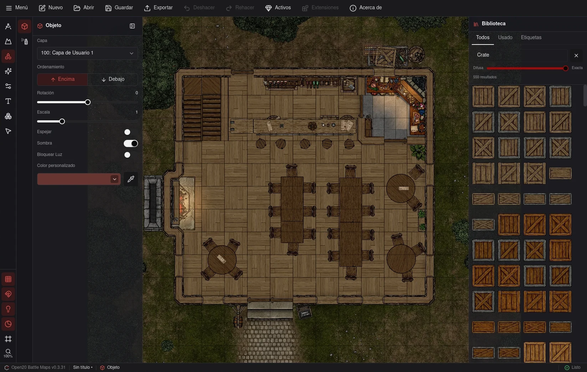

# Open20 Battle Maps

**El editor de mapas para tus partidas de rol.**

Dibuja edificios, cuevas, terreno y agua, llénalos de objetos e ilumínalos. 
Gratis para Windows, macOS, Linux y Android.

[**Descargar**](#descarga) · [open20.app](https://open20.app/battle-maps) · [Discord](https://discord.gg/KRHJm8x6rp)

 

## Qué puedes hacer

- **Trae tus mapas de Dungeondraft** y usa los packs de assets que ya tienes.
- **Edificios, cuevas, terreno, agua y caminos** en pocos clics.
- **Luces, techos y varios niveles** en el mismo mapa.
- **Open20 Essentials incluido**: más de 2.000 assets para empezar sin instalar nada.
- **Exporta a PNG** para tu mesa virtual o para imprimir.

## Descarga

| Sistema                               | Descarga                                                                                                                                      |
| ------------------------------------- | --------------------------------------------------------------------------------------------------------------------------------------------- |
| Windows                               | [Instalador (.exe)](https://github.com/open20-rpg/open20-battlemaps/releases/latest/download/Open20-Battle-Maps-windows-setup.exe)            |
| macOS (Apple Silicon, M1 o posterior) | [Imagen de disco (.dmg)](https://github.com/open20-rpg/open20-battlemaps/releases/latest/download/Open20-Battle-Maps-macos-apple-silicon.dmg) |
| macOS (Intel)                         | [Imagen de disco (.dmg)](https://github.com/open20-rpg/open20-battlemaps/releases/latest/download/Open20-Battle-Maps-macos-intel.dmg)         |
| Linux                                 | [AppImage](https://github.com/open20-rpg/open20-battlemaps/releases/latest/download/Open20-Battle-Maps-linux.AppImage)                        |
| Android                               | [APK](https://github.com/open20-rpg/open20-battlemaps/releases/latest/download/Open20-Battle-Maps-android.apk)                                |

Todas las versiones y sus novedades están en [Releases](https://github.com/open20-rpg/open20-battlemaps/releases).

### La primera vez que lo abres

La app todavía no está firmada por Microsoft ni por Apple, así que el sistema
avisa antes de abrirla:

- **Windows**: en el aviso de SmartScreen, _Más información_ › _Ejecutar de todas formas_.
- **macOS**: intenta abrirla una vez; después ve a _Ajustes del Sistema_ › _Privacidad y seguridad_ y pulsa _Abrir igualmente_.
- **Linux**: dale permiso de ejecución al archivo (`chmod +x`) y ábrelo.
- **Android**: permite instalar apps de este origen cuando el teléfono lo pida.

## Comunidad

Novedades, ideas y reportes de errores en [Discord](https://discord.gg/KRHJm8x6rp).
Si Battle Maps te sirve, puedes apoyar el proyecto en [Patreon](https://www.patreon.com/open20rpg).

Battle Maps es parte de [Open20](https://open20.app), una suite de herramientas
para juegos de rol.

---

Open20 Battle Maps es un proyecto independiente, sin afiliación con Dungeondraft
ni Megasploot. El pack Open20 Essentials incluye material del System Reference
Document 5.2.1 ("SRD 5.2.1") de Wizards of the Coast LLC, disponible en
https://www.dndbeyond.com/srd, bajo licencia
[Creative Commons Attribution 4.0](https://creativecommons.org/licenses/by/4.0/legalcode).

Battle Maps es gratis para uso no comercial bajo la
[Prosperity Public License 3.0.0](LICENSE). El pack Open20 Essentials tiene su
propia licencia, [CC BY 4.0](https://github.com/open20-rpg/open20-essentials#licencia).

¿Quieres colaborar con código? La guía para desarrollar está en [`AGENTS.md`](AGENTS.md).
